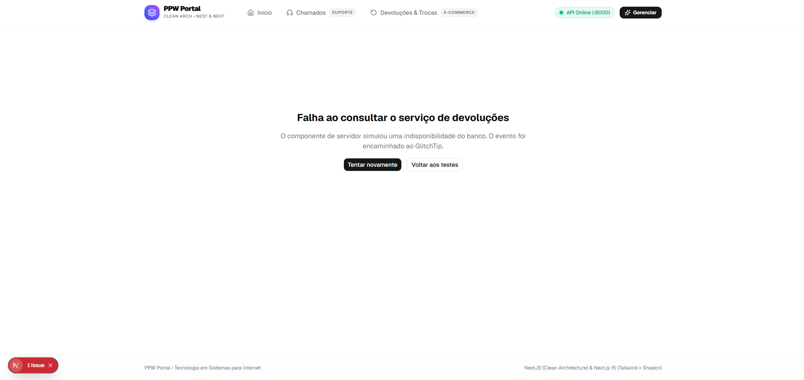
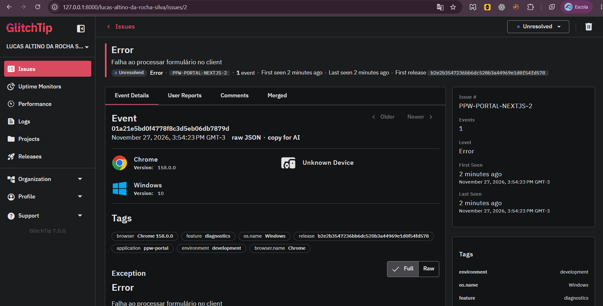
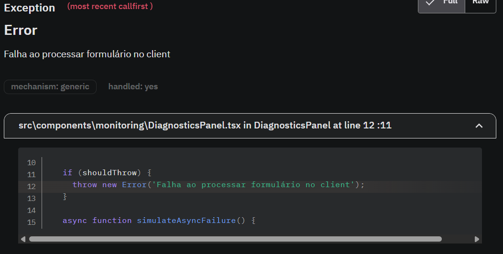

# Evidências de resiliência e GlitchTip

Capturas feitas no ambiente local do PPW Portal:

1. `01-error-boundary-server.png` — interface do `error.tsx` após a falha simulada do Server Component.
2. `02-nextjs-runtime-error.png` — detalhe da falha intencional de renderização no navegador durante o desenvolvimento.
3. `03-glitchtip-evento.png` — evento do client-side no GlitchTip, com ambiente `development` e tags do projeto.
4. `04-glitchtip-stacktrace.png` — exceção e quadro do stack trace no GlitchTip.

